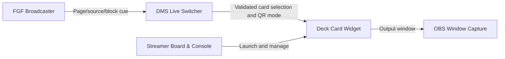

<div align="center">

# 🃏 Deck Card Widget
### Your stream. Your cards. Two presentation modes. One live controller.

**A local-first Python/Tkinter overlay toolkit for OBS and the DigiMancer streamer ecosystem.**

[](https://www.python.org/) [](#requirements) [](#release-status) [](#data-formats-and-privacy) [](#live-studio-workflow)

**[Quick start](#quick-start) · [Features](#features) · [Dual-side editor](#full-data--qr-data) · [Studio integrations](#live-studio-workflow) · [Safety](#data-formats-and-privacy)**

</div>

---

## What is Deck Card Widget?

Deck Card Widget (**DCW**) is a low-resource desktop controller for building and displaying stream-ready cards: partnerships, sponsors, information, URLs, QR codes, reactions, and other on-screen elements. Each card can combine editable text with PNG, emoji, and text layers. The output window is designed for capture in OBS while the controller stays available behind the scenes.

DCW offers **two separately editable visual sides** to the same card, **Full-Data** and **QR-Data**, plus a live mode switch that can be driven either from DCW or by DMS Live Switcher. A card keeps its underlying information regardless of its current visual presentation.

> [!IMPORTANT]
> **Alpha software.** Save backups of existing `.buttstore` collections before testing the dual-side editor. Older DCW releases may ignore and overwrite the newer `data_sides` metadata when saving.

## Features

| Area | Capabilities |
|:--|:--|
| Cards | Reusable deck-card buttons, saved collections, active card switching and output visibility |
| Content | Source type, confidence, verdict, source link and multiple boxed text areas |
| Layers | PNG images, emoji stickers and text elements; positioning and visibility controls |
| Full-Data | Text-forward card layout for reading and discussion |
| QR-Data | Large QR/fallback area, deck information panel, logo and sponsor space |
| Live control | `QR-Data Live` ON/OFF in the controller; DMS can request and confirm the same global mode |
| Export | Card image export and saved `.buttstore` collections; standalone card workflows may use `.deckbutt` |
| Local studio | Works as an independent OBS overlay or as part of SBC ↔ DMS ↔ FGF |

## Full-Data & QR-Data

### Two sides, one card

Each saved card has its own preferred display mode. The **QR-Data Live** button changes the active editing/output view without deleting the saved preference. Cards explicitly pinned to QR-Data retain their saved behavior in the normal DMS flow.

For PNG, emoji, and text objects, the dual-side editor can store:

- **Different positions** in Full-Data and QR-Data, starting from the same inherited coordinates on older cards.
- **Different visibility** on each side; hiding on one side does not automatically hide the other.
- Mutually exclusive **Full-Data ONLY** and **QR-Data ONLY** options. With neither selected, an object may appear on either side.
- **Side-aware deletion:** keep a shared object on the other side or delete it from both sides after confirmation.

### QR-Data layout editor

Shared QR geometry lets a collection use a consistent QR-Data composition. Controls cover the outer frame, QR/fallback rectangle, logo zone, title/data lanes, upper-right deck information, lower-right sponsor zone and related text boundaries.

If a QR link is unavailable, the saved fallback choice can show an empty QR region or selected text content. The text renderer fits centered fallback copy into the QR area (including the large-text edge case tested at 860 characters). Right-side QR link information displays without a `QR LOC:` prefix and clips extra characters silently. The upper-left data lanes retain their own ellipsis behavior.

## Quick start

### Requirements

- Python 3 and Tkinter; install optional image/QR dependencies listed by the repository's current requirements or setup instructions.
- A desktop environment capable of opening native Tk windows. OBS is optional unless you're capturing the output in a live scene.
- A writable local directory for saved collections and artwork.

```bash
# From a downloaded or cloned Deck-Card-Widget repository
python3 3dcp_perspective_console.py
```

If your checkout includes a `requirements.txt`, follow its instructions before launching. On Linux, install the distribution's Tk package when `import tkinter` is unavailable. The controller and output window are separate, capture the **output window**, not the editor.

### First card test

1. Open a card and confirm its saved text fields and source link.
2. Add a PNG or emoji and save a **copy** of the `.buttstore` collection.
3. Toggle `QR-Data Live`, reposition the object on QR-Data, and switch back to confirm Full-Data retained its position.
4. Apply **QR-Data ONLY** to one test object, then confirm it does not appear on Full-Data.
5. Reload your saved copy and test both sides again before using it on stream.

## Live studio workflow



- **[DMS Live Switcher](https://github.com/DigiMancer3D/DMS-Live-Switcher)** provides `Change Display: FULL-DATA / QR-DATA` and reports OFFLINE when DCW isn't running.
- **[Field Guide Forge](https://github.com/DigiMancer3D/Field-Guide-Forge)** can map presenter pages, sources or blocks to card IDs and request mode changes *through DMS*.
- **[Streamer Board & Console](https://github.com/DigiMancer3D/Streamer-Board-Console)** launches compatible apps and manages pinboard-related studio outputs.
- **[DMST](https://github.com/DigiMancer3D/DMST)** is the parent index for this tool family.

Only local studio actions you explicitly configure are automated. Deck Card Widget is usable without DMS, FGF or SBC.

## Data formats and privacy

| File | Purpose | Public repository? |
|:--|:--|:--|
| `.buttstore` | Saved collection of cards and layout metadata | **No** for real show data; sanitized demo only |
| `.deckbutt` | Reusable individual card, where supported | Sanitized examples only |
| `3dcp_perspective_console.py` | Main controller/source | Yes |
| `dcw_dualside.py` | Dual-side layer logic | Yes |
| `dms_qr_display_deck.py` | DMS integration, if installed | Yes, after reviewing for secrets |
| Personal PNGs/emoji libraries | Creative assets, paths and episode data | Only with appropriate permission |

Do **not** commit private `.buttstore` collections, source URLs intended to remain private, pairing tokens, `user_data/`, dated `.bak` files or `.pre-*` backups. Keep real episode content and machine-specific paths out of examples.

## Troubleshooting

<details><summary><strong>DMS says OFFLINE</strong></summary>

Start DCW first and confirm its output/controller process is running. Restart DMS to refresh the connection; use both applications' current bridge modules.

</details>

<details><summary><strong>The QR toggle appears to ignore an individually configured QR card</strong></summary>

Saved per-card QR preferences and the global live override are distinct. Test the same switch using a normal Full-Data card, then verify the saved card preference.

</details>

<details><summary><strong>A PNG moves on both sides</strong></summary>

Check that your checkout includes the dual-side module and that the installed controller actually loads it. Save and reload a *copy* of the collection before making further edits.

</details>

---

## Project & credits

Built by **[DigiMancer3D](https://github.com/DigiMancer3D)** for the [DigiMancer Streamer Tools](https://github.com/DigiMancer3D/DMST) ecosystem, including [3D Changes Perspectives](https://github.com/DigiMancer3D/3DChangesPerspectives).

**License:** See this repository's `LICENSE` file, if provided. No license is implied by this README alone.
